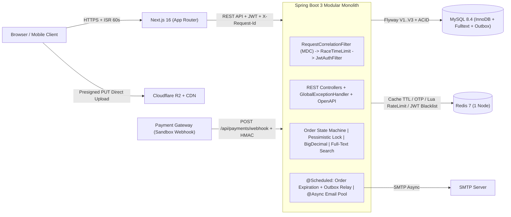
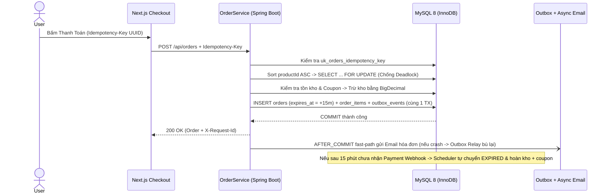

# IPWORLD Store — Full-Stack E-Commerce System (Modular Monolith)

Hệ thống bán hàng thiết bị công nghệ **IPWORLD** được xây dựng theo kiến trúc **Modular Monolith chuẩn Production**, tập trung giải quyết bài toán thực chiến của E-commerce: chống bán âm kho (**overselling**), chống **Deadlock DB**, **Idempotency**, **Order State Machine**, **Payment Webhook HMAC**, **Transactional Outbox**, **Redis Caching / OTP / Distributed Rate Limiting**, và **JWT Refresh Rotation + Blacklist**.

---

## 1. Kiến trúc hệ thống (System Design)



### Luồng Checkout chống Overselling, Deadlock & mất Email (Sequence)



---

## 2. Tech Stack (Gọn, thực chiến, không dư thừa)

| Tầng | Công nghệ | Vai trò cụ thể |
| :--- | :--- | :--- |
| **Frontend** | Next.js 16 (App Router, ISR), React 19, TypeScript, Tailwind CSS 4 | SSR/ISR cho trang chủ & danh mục, tự động Refresh Access Token qua HttpOnly Cookie |
| **Backend** | Java 21, Spring Boot 3.3, Spring Security, Spring Data JPA, Springdoc OpenAPI | Modular Monolith REST API, `@RestControllerAdvice`, Actuator, Swagger UI |
| **Database** | MySQL 8.4 + **Flyway** (`V1`, `V2`, `V3`) + `ddl-auto=validate` | `DECIMAL(15,2)` tiền tệ, Composite Index, MySQL `FULLTEXT` Index, bảng `outbox_events` |
| **In-Memory / Cache** | **Redis 7** (graceful fallback sang Caffeine khi Redis sập/chạy local) | Cache phân tầng TTL, OTP Hash TTL + `HINCRBY`, Distributed Rate Limit (Lua Script), JWT Blacklist & Refresh Rotation |
| **Object Storage** | **Cloudflare R2** (S3-compatible + Presigned PUT URL) | Tách toàn bộ ảnh & video 4K khỏi repo, upload video trực tiếp không qua băng thông server |
| **DevOps & QA** | Docker Multi-stage, Docker Compose, GitHub Actions CI, JUnit 5, MockMvc, k6 | Chạy full-stack 1 lệnh, CI tự động test + build, k6 kiểm chứng concurrent checkout |

---

## 3. Các quyết định thiết kế (Engineering Trade-offs)

1. **Tại sao chọn Modular Monolith thay vì Microservices?**
   Với quy mô web bán hàng vài nghìn đến vài chục nghìn người dùng/ngày, Modular Monolith giữ được **ACID transaction đơn giản** (trừ kho + trừ coupon + tạo đơn + ghi outbox trong cùng 1 transaction), không chịu độ trễ mạng RPC hay chi phí vận hành Saga/Service Mesh. Cấu trúc gói tách rõ theo domain giúp dễ tách service sau này khi lưu lượng tăng đột biến.
2. **Tại sao dùng Pessimistic Lock (`SELECT ... FOR UPDATE`) + sắp xếp `productId` tăng dần?**
   Khi Flash Sale có nhiều luồng tranh mua cùng 1 sản phẩm, Optimistic Lock gây tỷ lệ retry/failure rất cao. Pessimistic Write Lock kết hợp **lock ordering theo `productId` tăng dần** vừa đảm bảo tuyệt đối không âm kho vừa triệt tiêu chu trình Deadlock giữa 2 đơn hàng mua chéo sản phẩm `[A, B]` và `[B, A]`.
3. **Tại sao dùng Transactional Outbox thay vì chỉ `@Async` hoặc kéo thêm Kafka?**
   `@Async` thuần lưu tác vụ trong RAM — nếu server crash ngay sau DB commit sẽ mất email hóa đơn. Bảng `outbox_events` ngay trong MySQL + `@Scheduled` relay có exponential backoff giải quyết bài toán **At-Least-Once Delivery** mà không phải vận hành cụm Kafka/RabbitMQ cồng kềnh.
4. **Tại sao dùng MySQL `FULLTEXT INDEX` thay vì `LIKE '%keyword%'` hoặc Elasticsearch?**
   `LOWER(name) LIKE '%keyword%'` khiến B-Tree index vô dụng (Full Table Scan). `FULLTEXT INDEX` trên MySQL 8 đáp ứng rất tốt ở quy mô dưới ~500.000 sản phẩm; chỉ cần tách sang Meilisearch/Elasticsearch khi cần fuzzy typo-tolerance hoặc faceted search phức tạp.
5. **Tại sao bỏ DynamoDB, Nodemailer/Resend ở Next.js và Cloudinary?**
   Gom **Single Source of Truth** về Backend Spring Boot + Redis giúp loại bỏ sự phân mảnh bảo mật, giảm phụ thuộc hạ tầng thừa, và thống nhất xác thực OTP/Email/RateLimit trên 1 node Redis duy nhất.

---

## 4. Chạy nhanh toàn hệ thống bằng Docker

```bash
docker compose up --build
```

- **Frontend:** http://localhost:3000
- **Backend API:** http://localhost:8081
- **Swagger UI (OpenAPI 3):** http://localhost:8081/swagger-ui.html
- **Health Check (Actuator):** http://localhost:8081/actuator/health

### Chạy kiểm thử tự động & Load Test

```bash
# 1. Backend Unit, API & Integration Tests (H2 + Flyway V1..V3)
cd "demo (7)/demo" && ./mvnw test

# 2. Frontend Lint & Production Build
cd frontend/frontend-quanlybanhang && npm run lint && npm run build

# 3. k6 Concurrent Checkout Load Test (50 VUs tranh mua cùng 1 sản phẩm)
k6 run -e BASE_URL=http://localhost:8081/api -e TOKEN=<ACCESS_TOKEN> -e PRODUCT_ID=1 load-tests/checkout-concurrency.js
```
